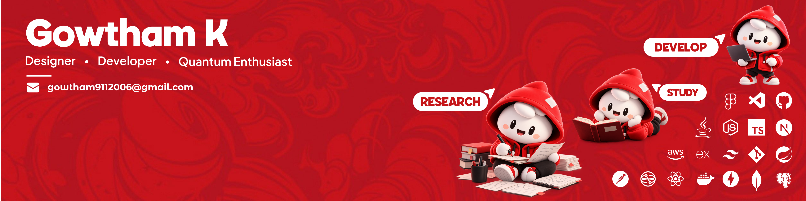

  

# Hey, I'm Gowtham.

**Software engineer · Co-founder at DoodleByte Studio · Chennai, India**

I build software people use: stores that take real orders, tools that deploy apps, and payment systems that hold up under concurrency. I like working across the whole system, from the interface to the database to the server it runs on.

  
  &nbsp;
  
  &nbsp;
  

---

## 

### 01 / nextship
**Deploy Next.js to infrastructure you own.**

An open-source CLI for deploying to DigitalOcean or your own Linux server, with logs and rollback. Built around the parts that make deployment trustworthy: reproducible builds, compatibility checks, and a way back when something goes wrong.

- Passes the official Next.js deployment adapter compatibility suite, with documented skips.
- Reduced a measured Docker image from **1.13 GB to 591 MB** through pruning.

`TypeScript` `Docker` `GitHub Actions` `Linux`

[Source code](https://github.com/gowtham472/nextship) · [Documentation & quick start](https://nextship.doodlebytestudio.in/)

### 02 / Narpadham Foods
**A real storefront, with real checkout problems to solve.**

Built and operate an online food store through DoodleByte Studio, with payments, inventory, and WhatsApp ordering. PostgreSQL row locks protect stock during simultaneous checkouts; verified, idempotent webhooks make payment retries safe.

`Next.js` `TypeScript` `PostgreSQL` `Payments`

[Visit Narpadham Foods](https://narpadhamfoods.com/)

### 03 / Santru
**Let an AI agent shop. Keep the spending rules deterministic.**

A payment system built for the Razorpay AI Buildathon, where an agent can transact only within a user-signed spending mandate. A rules engine approves payments, with signatures, replay protection, and an auditable ledger.

**Zero double charges in a 200-request concurrency test · 232 automated tests**

`TypeScript` `PostgreSQL` `MCP` `Razorpay`

### 04 / ADI
**Understand what an infrastructure change could break before deploying it.**

Builds a dependency graph of an AWS CloudFormation stack, predicts the impact of a change, and checks those predictions against CloudWatch after deployment. In a live test, it flagged a security-group port typo before CloudWatch confirmed the resulting database outage.

`TypeScript` `AWS Lambda` `Step Functions` `DynamoDB` `Bedrock`

## 

At **DoodleByte Studio**, I also built an invoice automation system that reads vendor invoices with OCR, validates GST details, and imports approved invoices into TallyPrime.

During my internships at **Sri Sairam Techno Incubator Foundation**, I led work on **Sairam eMoU Vault**, adopted by **8 departments**, and **Noto**, an internal project management platform with role-based access and **155 REST APIs**.

<strong>More things I've been working on</strong>

- **Vellam:** street-level flood risk for India, with 48-hour forecasts and rising-risk email alerts; rechecks 40 cities every three hours.
- **[Zcan](https://zcan.in/):** campus food pre-ordering, real-time order updates, online payments, and receipt printing.
- **LATTICE:** finding quantum-vulnerable cryptography in source code and binaries, built in Rust.
- **HerbaScope:** identifying medicinal plants from microscope images using computer vision.
- **SAAP:** a student achievements portal for Sairam CSE.
- **Losto:** an offline study library PWA.
- **QSDTS:** ongoing research into quantum-secure communication with Python and Qiskit.

## 

| Area | Technologies |
| :--- | :--- |
| Languages | TypeScript, JavaScript, Python, Java, SQL |
| Web & APIs | React, Next.js, Node.js, Express, FastAPI |
| Data | PostgreSQL, MongoDB, Firebase, DynamoDB |
| Infrastructure | AWS, Docker, Linux, Git, GitHub Actions |
| Testing | Vitest, pytest, integration testing, end-to-end testing |

The details I keep coming back to: **safe retries, database concurrency, access control, audit trails, and deployments you can roll back.**

## 

I'm studying **Computer Science and Engineering at Sri Sairam Engineering College** (2024–2028), with a **9.38/10 CGPA**. My projects span developer tooling, commerce, cloud infrastructure, and security.

If you're working on something in those areas, [let's talk](mailto:gowtham9112006@gmail.com).
